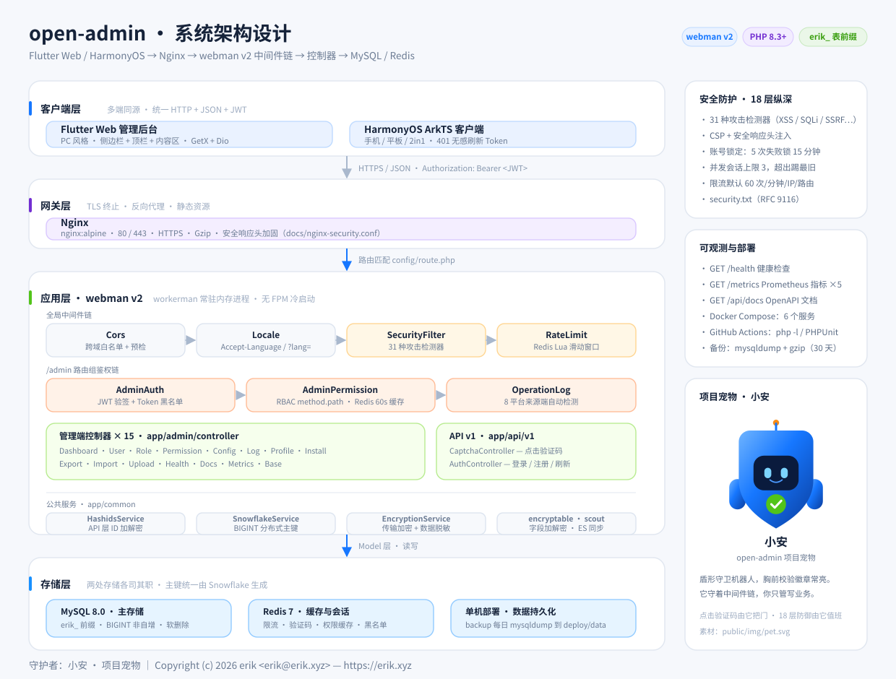
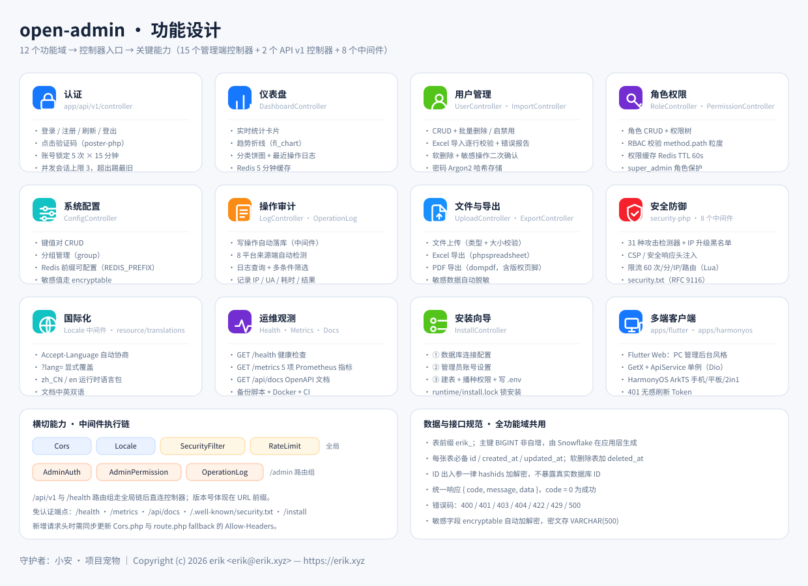
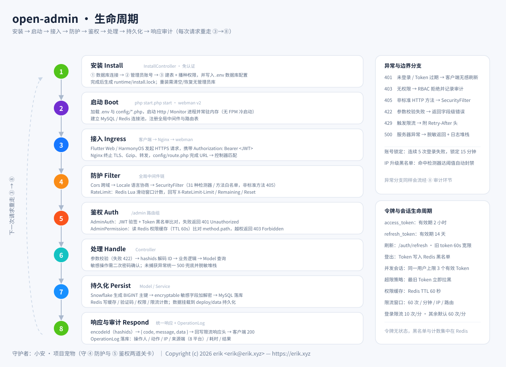

# 开放管理后台 (open-admin)


基于 **webman v2 + Flutter** 的全栈管理后台系统：认证与 RBAC 权限、18 层纵深防御、Prometheus 可观测、多端客户端（Flutter Web / HarmonyOS）。

> 项目宠物「**小安**」是一只盾形守卫机器人，守在中间件链的「防护」与「鉴权」两道关卡上。
> 素材 [`public/img/pet.svg`](public/img/pet.svg)：纯 SVG（无脚本、无外部依赖、支持深色底与 `prefers-reduced-motion`），同时用作站点图标。
>
> 设计图：[系统架构](docs/diagrams/architecture.svg) · [功能设计](docs/diagrams/features.svg) · [生命周期](docs/diagrams/lifecycle.svg)
>
> 项目官网：[中文](https://package.erik.xyz/open-admin/) · [English](https://package.erik.xyz/open-admin/en/) · [本地源码](site/index.html)（响应式静态站点，无后端依赖）

> [English](docs/translations/README.en.md) | [架构设计图](docs/ARCHITECTURE.md) | [设计文档](docs/DESIGN.md) | [安全架构](docs/SECURITY.md) | [API 参考](docs/API.md)

## 项目宠物 · 小安


**小安**（Xiao An）是 open-admin 的项目宠物，取自「**安**全」与「管理后**台**」——一只盾形守卫机器人。

- **盾形身体** — 对应 18 层纵深防御；顶部天线常亮，代表服务常驻内存（webman/workerman）
- **面屏双瞳** — 会定时眨眼；它盯着每一次请求，也盯着中间件链
- **胸前校验徽章** — 对勾常亮，代表 `method.path` 权限校验通过

**它出现在哪里**

| 位置 | 形式 |
|------|------|
| 站点首页 `GET /` | 主形象 + 项目简介与入口导航（[`app/view/index/view.html`](app/view/index/view.html)） |
| 安装向导 `/install` | 三步向导的页头形象（`InstallController::layout()`） |
| 浏览器标签页 | 站点图标 `rel="icon" type="image/svg+xml"` |
| 本文档与设计图 | 项目头像 + 架构图右下角的宠物卡片 |

> 素材单一来源：[`public/img/pet.svg`](public/img/pet.svg)。修改它即同时更新以上全部位置。

**自己画一个？** 图标规范：主色 `#1677FF`、暖色天线 `#FA8C16`、校验绿 `#52C41A`；画布 `240 × 320`，盾形居中，最小可用尺寸 48 px。


## 项目宠物表情形态 · 小安

| 表情 | 预览 | 短码 |
|---|---|---|
| 笑 |  | `:emoji-smile:` |
| 欢乐 |  | `:emoji-joy:` |
| 哭 |  | `:emoji-cry:` |
| 沮丧 |  | `:emoji-depressed:` |
| 惊恐 |  | `:emoji-terrified:` |
| 愤怒 |  | `:emoji-angry:` |
| 撒娇 |  | `:emoji-coquettish:` |
| 卖萌 |  | `:emoji-cute:` |
| 讨好 |  | `:emoji-pleasing:` |
| 敲打 |  | `:emoji-knocking:` |
| 捂脸 |  | `:emoji-facepalm:` |
| 吐舌头 |  | `:emoji-tongue:` |

> 12 种彩色动态形态：笑 / 欢乐 / 哭 / 沮丧 / 惊恐 / 愤怒 / 撒娇 / 卖萌 / 讨好 / 敲打 / 捂脸 / 吐舌头。每个 SVG 自带表情、情绪特效与整体动效，并遵循 `prefers-reduced-motion`。

## 视觉资产授权 / Visual Assets License

本项目的项目宠物、图片、图标、表情（包括 `docs/pet-expressions/` 等目录下的
SVG / PNG）**不是开源资产**，版权归作者所有。未经书面许可不得复制、修改、再分发或
用于商业用途；商业使用需取得商业授权，联系 **erik@erik.xyz**。详见
[ASSETS-LICENSE.md](ASSETS-LICENSE.md)。

> 代码部分采用 [MIT License](LICENSE) 开源；第三方素材（如明确标注的 Go Gopher 等）仍遵循其原许可证。

## 功能清单

| 业务域 | 功能 | 说明 |
|--------|------|------|
| 🔐 认证 | 登录/刷新令牌/登出 | 点击验证码 + JWT + 黑名单 |
| | 账号锁定 | 5 次失败锁定 15 分钟 |
| | 并发会话限制 | 同一用户最多 3 个有效 Token |
| 📊 仪表盘 | 实时统计/趋势图/分布图/最近操作 | Redis 缓存 5 分钟 |
| 👥 用户管理 | CRUD + 批量删除/启禁用 | 软删除 + 密码二次确认 |
| | Excel 批量导入 | 逐行校验 + 错误报告 |
| 🔒 角色权限 | 角色 CRUD + 权限树 | RBAC method.path 粒度鉴权 |
| ⚙ 系统配置 | 键值对 CRUD | 分组管理 |
| 📋 操作审计 | 日志查询 + 来源端检测 | 8 平台自动识别 |
| 📁 文件管理 | 上传/Excel 导出/PDF 导出 | 敏感数据自动脱敏 |
| 🛡 安全防护 | 18 层纵深防御 | XSS/SQL注入/路径遍历/命令注入/CSRF/限流/CSP... |
| 🏥 运维 | 健康检查/metrics/API 文档/security.txt | Prometheus + OpenAPI 3.0 + erikwang2013/apidoc-php 交互文档 |
| 🌐 国际化 | 中英文切换 | Accept-Language 头 / ?lang= 参数 |

## 技术栈

| 层 | 技术 | 说明 |
|---|------|------|
| 后端框架 | webman v2 (workerman) | 超高性能 PHP 常驻进程框架 |
| PHP 版本 | 8.3+ | |
| 数据库 | MySQL 8.0+ | 表前缀 `erik_`，BIGINT 非自增主键 |
| 管理端前端 | Flutter 3.x | Web 端为 PC 管理后台风格（`apps/flutter/`） |
| 移动端 | HarmonyOS ArkTS | 鸿蒙原生客户端（`apps/harmonyos/`），支持手机/平板/2in1 |

## 核心依赖

| 包 | 用途 |
|---|------|
| `erikwang2013/snowflake-php` | Snowflake 算法生成全局唯一 BIGINT 主键 |
| `erikwang2013/hashids` | API 层 ID 加解密，隐藏真实数据库 ID |
| `erikwang2013/jwt-webman` | JWT 认证令牌签发与校验 |
| `erikwang2013/encryption` | 接口传输层敏感数据加解密 |
| `erikwang2013/encryptable` | 数据库存储层敏感字段自动加解密 |
| `erikwang2013/season` | 国家旗帜数据 |
| `erikwang2013/poster-php` | 点击验证码生成与校验 + 海报生成 |
| `phpoffice/phpspreadsheet` | Excel 导出 |
| `barryvdh/laravel-dompdf` | PDF 导出（基于 Dompdf） |

## 项目结构

```
open-admin/
├── app/
│   ├── admin/controller/       # 管理端控制器
│   │   ├── DashboardController.php # 仪表盘（Redis缓存）
│   │   ├── UserController.php      # 用户 CRUD + 批量操作
│   │   ├── RoleController.php      # 角色 CRUD
│   │   ├── PermissionController.php# 权限 CRUD
│   │   ├── ConfigController.php    # 系统配置 CRUD
│   │   ├── LogController.php       # 操作日志查询
│   │   ├── ProfileController.php   # 个人中心 + 登出
│   │   ├── ExportController.php    # Excel/PDF 导出
│   │   ├── ImportController.php    # Excel 导入用户
│   │   ├── UploadController.php    # 文件上传
│   │   ├── HealthController.php    # 健康检查
│   │   ├── DocsController.php      # OpenAPI 文档
│   │   └── BaseController.php      # 基础控制器
│   ├── api/
│   │   └── v1/controller/          # API v1 控制器（版本体现在 URL 前缀 /api/v1）
│   │       ├── CaptchaController.php # 点击验证码
│   │       └── AuthController.php    # 登录/刷新令牌
│   ├── common/                 # 公共工具类
│   │   ├── HashidsService.php  # ID 编解码
│   │   ├── SnowflakeService.php# Snowflake ID 生成
│   │   └── EncryptionService.php # 数据加解密 + 脱敏
│   ├── middleware/             # 中间件
│   │   ├── Cors.php            # 跨域
│   │   ├── SecurityFilter.php  # 攻击检测拦截（HTTP方法限制/XSS/SQL注入/路径遍历/命令注入/CSRF）
│   │   ├── RateLimit.php       # Redis 限流（滑动窗口 + 响应头）
│   │   ├── AdminAuth.php       # JWT 认证 + 黑名单
│   │   ├── AdminPermission.php # RBAC 权限校验
│   │   └── OperationLog.php    # 操作日志自动记录（含来源端检测）
│   ├── model/                  # 数据模型
│   ├── view/index/view.html    # 站点首页模板（GET /，含项目宠物与入口导航）
│   ├── queue/                  # 队列任务
│   └── process/                # 进程 (Http, Monitor)
├── apps/
│   ├── flutter/                # Flutter Web 管理后台（PC 风格）
│   │   ├── lib/app/
│   │   │   ├── pages/          # 6 个完整页面（仪表盘/用户/角色/配置/日志/个人中心）
│   │   │   ├── services/       # ApiService（JWT 拦截器）+ AuthService（Token 持久化）
│   │   │   ├── layouts/        # 响应式管理后台布局（侧边栏+顶栏+内容区）
│   │   │   └── theme/          # Material 3 双主题
│   │   └── web/index.html      # Web 入口（标题/描述/站点图标）
│   └── harmonyos/              # HarmonyOS 原生客户端（Token 无感刷新）
├── config/                     # 配置文件（含中文注释）
│   ├── route.php               # 路由 + API 版本策略
│   ├── middleware.php          # 全局中间件注册
│   └── ...                     # 各组件配置
├── database/                   # 数据库脚本
│   ├── install.sql             # 全量安装脚本（含权限种子数据）
│   └── backup/                 # 备份与恢复脚本
├── docs/                       # 文档
│   ├── ARCHITECTURE.md         # 架构设计图（Mermaid）
│   ├── DESIGN.md               # 设计文档
│   ├── SECURITY.md             # 安全架构设计
│   ├── API.md                  # API 参考文档
│   ├── diagrams/               # 图表目录
│   │   ├── architecture.svg    # 系统架构设计图（SVG）
│   │   ├── features.svg        # 功能设计图（SVG）
│   │   ├── lifecycle.svg       # 生命周期图（SVG）
│   │   └── 01..12-*.md         # 分解图（Mermaid，中英双语）
│   └── translations/           # 英文文档（README.en / CLAUDE.en）
├── public/                     # 公共入口（Web 根目录）
│   ├── img/pet.svg             # 项目宠物「小安」（SVG，兼作站点图标）
│   └── favicon.ico             # 兼容旧浏览器的 .ico 兜底
├── site/                       # 响应式静态官网（HTML/CSS/JS + 本地资源）
├── deploy/                     # 单机生产编排（compose + 密钥生成 + Nginx/TLS）
├── resource/translations/      # 运行时语言包（zh_CN / en）
├── tests/                      # PHPUnit 测试
├── runtime/                    # 运行时文件
└── vendor/                     # Composer 依赖
```

## 架构设计与图表

三张图均为**纯手写 SVG**（无脚本、无外部字体依赖、可无限缩放），可直接在 GitHub / 浏览器中查看，也可插入 PPT 与文档：

| 图 | 内容 | 文件 |
|---|------|------|
| 系统架构设计 | 四层拓扑：客户端层 → 网关层 → webman 应用层（中间件链 / 控制器 / 公共服务）→ 存储层，右侧含安全与可观测性 | [`docs/diagrams/architecture.svg`](docs/diagrams/architecture.svg) |
| 功能设计 | 12 个功能域 → 控制器入口 → 关键能力，底部为中间件执行链与数据接口规范 | [`docs/diagrams/features.svg`](docs/diagrams/features.svg) |
| 生命周期 | 安装 → 启动 → 接入 → 防护 → 鉴权 → 处理 → 持久化 → 响应审计，含异常分支与令牌生命周期 | [`docs/diagrams/lifecycle.svg`](docs/diagrams/lifecycle.svg) |







> 需要可编辑的源码级图表时，见 [`docs/ARCHITECTURE.md`](docs/ARCHITECTURE.md) 与 [`docs/diagrams/`](docs/diagrams/)（Mermaid，可粘贴到 [Mermaid Live](https://mermaid.live/) 编辑）。

## 环境要求

- PHP >= 8.3
- Composer 2.x
- MySQL >= 8.0
- Flutter >= 3.41（仅前端开发需要）

## 快速开始

### 1. 安装依赖

```bash
composer install
```

### 2. 配置环境变量

复制并修改环境变量（可选，不配置则使用 `config/*.php` 中的默认值）:

```bash
cp .env.example .env
```

关键配置项：

| 环境变量 | 说明 | 默认值 |
|---------|------|--------|
| `JWT_SECRET_KEY` | JWT 签名密钥（`config/jwt.php` 实际读取；`JWT_SECRET` 为旧别名，建议保持同值） | `open-admin-jwt-secret-change-in-production` |
| `HASHIDS_SALT` | Hashids 盐值 | `open-admin-hashids-salt-2026` |
| `ENCRYPTION_KEY` | API 加密密钥 | 32 字节默认值 |
| `SNOWFLAKE_DATACENTER_ID` | 数据中心 ID (0-31) | `1` |
| `SNOWFLAKE_WORKER_ID` | 工作节点 ID (0-31) | `1` |

**生产环境务必修改所有密钥为随机字符串。**

### 3. 一键安装

启动服务后，浏览器访问安装向导完成数据库初始化和管理员创建：

```bash
php start.php start
```

默认监听 `http://0.0.0.0:8791`（端口可在 `config/process.php` 修改）。

浏览器打开 **`http://localhost:8791/install`**，按向导填入：

| 步骤 | 内容 |
|------|------|
| ① 数据库配置 | 主机地址、端口、数据库名、用户名、密码 |
| ② 管理员设置 | 由向导创建管理员账号，表单为空，请自行填写用户名和密码（系统无内置默认账号） |

点击「开始安装」后自动完成建表、播种权限数据、创建管理员账号，并写入 `.env` 数据库配置。

> 安装完成后生成 `runtime/install.lock` 锁定文件。仅删除该文件**不足以**重装：安装程序发现数据库中已有管理员时会拒绝再次初始化。重新安装需要先清空或恢复为不含管理员的数据库（全新库），再删除 `runtime/install.lock`。

### 4. 登录

访问 `http://localhost:8791`，使用安装时设置的管理员账号密码登录。

### 5. 启动前端（可选）

**Flutter 管理后台（Web 端）:**

```bash
cd apps/flutter
flutter pub get
flutter run -d chrome    # Web 端（PC 管理后台风格）
```

**HarmonyOS 客户端（手机端）:**

使用 DevEco Studio 打开 `apps/harmonyos/` 目录，连接真机或模拟器运行。

### 6. Docker Compose 快速开始（本地/单机试跑）

> **⚠ 仅限本地试跑**：`.env.docker` 中的数据库密码、JWT/加密密钥均为公开且故意无效的占位值，**禁止直接暴露到公网**。首次启动前请先替换为有效值；生产环境请使用 `deploy/`（按服务隔离环境变量并自动生成随机密钥）。

项目根目录的 `docker-compose.yml` 提供 4 个服务的快速开始编排：Nginx、PHP (webman app)、MySQL、Redis。

```bash
# 1. 配置 Docker 环境变量（DB_HOST=mysql、REDIS_HOST=redis 已指向 compose 服务）
cp .env.docker .env

# 2. 启动所有服务
docker compose up -d

# 3. 浏览器访问安装向导完成初始化（Nginx 转发到 app:8791）
# http://localhost/install
# 数据库主机填写 mysql，端口 3306，库名/用户名/密码见 .env

# 4. 访问
# http://localhost  (Nginx: 静态官网 + 反向代理 webman)
# http://localhost/api/v1/...  (API)
```

- `Dockerfile`: PHP 8.3（Alpine）+ OPcache + zip/redis 扩展 + Composer
- `docker-compose.yml`: 4 个服务编排；app 仅在容器内网监听 8791，对外由 Nginx 暴露 80
- `.env.docker`: Docker 环境专用环境变量

> 生产环境请使用 `deploy/` 单机编排（nginx/app/init/mysql/redis/backup + 按服务隔离的环境变量 + 自动生成密钥 + TLS），见下文「部署」。


## 静态官网

`site/` 是本项目的响应式静态官网，中英文独立页面，内容涵盖项目介绍、功能矩阵、小安表情、架构图、安装与使用说明、版本日志、站内搜索、打赏与 404 页面。

- 纯静态 HTML/CSS/JS，无服务端渲染与数据库依赖。
- three.js、图片、样式与脚本均放在 `site/assets/`，不依赖外部 CDN；仅 Busuanzi 统计脚本异步加载。
- 本地预览：`python3 -m http.server 8800 --directory site`，浏览器打开 `http://localhost:8800/`。
- 在线站点：[中文](https://package.erik.xyz/open-admin/) / [English](https://package.erik.xyz/open-admin/en/)；本地请用上面的静态服务器预览。
- Nginx 参考配置将 `/open-admin/` 直接映射到根目录 `site/`。

## 数据库规范

- **表前缀**: `erik_`
- **主键**: 所有表主键均为 `id BIGINT UNSIGNED NOT NULL`，**禁用 AUTO_INCREMENT**
- **ID 生成**: 主键 ID 由应用层 `SnowflakeService::generate()` 生成，分布式唯一
- **必备字段**: 每张表必须包含 `id`, `created_at`, `updated_at`
- **软删除**: 需要软删除的表添加 `deleted_at DATETIME DEFAULT NULL`
- **敏感字段**: 手机号、邮箱、身份证号等使用 `encryptable` 插件自动加解密，数据库字段使用 `VARCHAR(500)` 存储密文

## API 文档

完整的 API 参考（统一响应格式、错误码、全部端点详情、认证流程、限流策略、中间件链路）见 **[docs/API.md](docs/API.md)**，要点如下：

- **统一响应格式**: `{ "code": 0, "message": "success", "data": {...} }`，`code=0` 表示成功
- **错误码**: `400` 参数错误 / `401` 未登录 / `403` 无权限 / `404` 不存在 / `422` 验证失败 / `429` 限流 / `500` 服务器错误
- **API 版本**: 版本号体现在 URL 前缀中（如 `/api/v1/...`），不使用请求头
- **认证**: `Authorization: Bearer {token}`；access_token 有效期 2 小时，refresh_token 14 天
- **ID 处理**: 请求/响应中的 ID 为 hashids 加密字符串，不暴露真实数据库 ID

## 前端说明

### Flutter 管理后台（PC 风格）

- **布局**: 侧边栏（可折叠 64px/240px）+ 顶栏 + 内容区，响应式三断点（手机/平板/桌面）
- **页面**: 登录、仪表盘、用户管理、角色权限、系统配置、操作日志、个人中心
- **状态管理**: GetX（`ApiService` 单例 + `AuthService` Token 持久化）
- **仪表盘**: 统计卡片、趋势折线图（fl_chart）、饼图、最近操作日志
- **导出**: Excel/PDF 导出，PDF 含不可移除版权信息
- **批量操作**: 多选批量删除、批量启用/禁用
- **主题**: Material 3 浅色/深色双主题

### HarmonyOS 移动端

- **页面**: 登录、仪表盘、用户列表/详情、个人中心
- **认证**: JWT Bearer + 401 自动无感刷新 Token，刷新失败自动重定向登录页
- **存储**: Token 通过 AppStorage 管理

## 开发规范

- 全局函数/类引用不加前置 `\`，统一使用 `use` 导入
- 所有 PHP 文件头部必须包含版权声明
- 所有配置文件必须包含中文注释说明
- 数据库主键必须由应用层 snowflake 生成，禁止自增
- API 层所有参数和响应中的 ID 必须通过 hashids 加解密
- AdminPermission 中间件使用 Redis 缓存用户权限（TTL=60s），消除 N+1 查询瓶颈

## 部署

### 快速开始（4 个服务）

项目根目录 `docker-compose.yml` 编排 `nginx`、`app`、`mysql`、`redis`，适合本地或单机试跑：

```bash
cp .env.docker .env
docker compose up -d
```

> **⚠ 仅限本地试跑**：`.env.docker` 默认密码/密钥为公开且故意无效的占位值，使用前先替换，禁止直接暴露公网；生产环境请使用下方 `deploy/` 编排。

### 生产部署（单机 6 个服务）

生产编排位于 `deploy/`，单机运行 `nginx`、`app`、`init`（一次性初始化）、`mysql`、`redis`、`backup`（每日自动备份），不依赖全文检索引擎：

| 服务 | 说明 |
|------|------|
| `nginx` | 80/443，TLS 终止、静态官网、反向代理到 `app:8791`；日志写 stdout/stderr |
| `app` | webman PHP 8.3 应用，容器内监听 8791，仅经 Nginx 暴露 |
| `init` | 一次性初始化：建表、创建管理员，完成后退出 |
| `mysql` | MySQL 8.0，数据持久化到宿主机目录；错误/慢日志写 stderr |
| `redis` | Redis 7，AOF 持久化到宿主机目录 |
| `backup` | 每日 `mysqldump` 到 `deploy/data/backups`，保留 30 天 |

```bash
cd deploy
./generate-secrets.sh          # 生成 master .env、各服务 env、密钥、自签名 TLS 证书与管理员密码
docker compose up -d --build
```

- **环境变量按服务隔离**：`deploy/env/{app,init,mysql,redis,backup}.env`（目录 `700`、文件 `600`）；master `deploy/.env` 仅保存 compose 插值所需的域名、端口与 `APP_UID`/`APP_GID`。应用容器拿不到 MySQL root 密码和初始化管理员密码。生成脚本会原位更新已知键并追加缺失键，保留自定义项。
- `generate-secrets.sh` 默认幂等，只补齐缺失值；同时生成 `deploy/secrets/rsa_public_key.pem`、管理员密码 `deploy/secrets/admin_password.txt`，RSA 私钥写入 `app.env` 的 `RSA_PRIVATE_KEY`。
- `--regenerate` 先归档旧的 `deploy/.env`、`deploy/env/` 与 `deploy/secrets/` 到 `deploy/secrets/archive/<时间戳>/`，默认只轮换 JWT/HASHIDS/ENCRYPTION/RSA/Redis 等应用密钥，并保留 `ENCRYPTABLE_KEY`、现有 TLS 证书（真实域名证书不会被覆盖）、`DB_PASSWORD`、`MYSQL_ROOT_PASSWORD` 与管理员密码，不会破坏已有数据库。需要轮换字段加密密钥用 `--rotate-encryptable`（旧密钥自动加入 `ENCRYPTION_PREVIOUS_KEYS`，旧数据仍可读取；完成数据重加密后再移除旧密钥），轮换 TLS 用 `--rotate-tls`，轮换数据库密码用 `--rotate-db`（脚本会打印需手动执行的 `ALTER USER` 命令），重置管理员密码用 `--reset-admin`。
- **宿主机属主**：`app`/`init` 以 `${APP_UID:-1000}:${APP_GID:-1000}` 运行，脚本用 `id -u`/`id -g` 写入 master `.env`，保证 `deploy/data/{runtime,upload}` 对宿主机用户可写。
- **日志**：Nginx 与 MySQL 写 stdout/stderr，由 Docker 按 `10m × 3` 轮转，用 `docker compose logs -f app` 查看；宿主机持久化目录为 `deploy/data/{mysql,redis,runtime,upload,backups}`。
- TLS：默认按 `DOMAIN`（默认 `localhost`）生成自签名证书；真实域名证书直接替换 `deploy/secrets/tls/fullchain.pem` 与 `privkey.pem`，脚本不会覆盖已有证书（`--rotate-tls` 除外）。80 端口仅放行 `/.well-known/acme-challenge/`，其余 301 到 HTTPS；HSTS 默认关闭，配置真实域名证书后再启用。
- 自动备份：`backup` 服务每天执行一次 `mysqldump`，写入 `deploy/data/backups` 并保留 30 天。
- RSA 公钥：`GET /api/v1/auth/public-key` 返回当前公钥，Flutter 登录前动态获取、失败时回退内置公钥；`--regenerate` 换钥后需确认该端点可达，依赖内置回退的旧客户端需重新构建。

PHP 镜像通过 `Dockerfile` 构建，基础镜像 `php:8.3-cli-alpine`，启用 OPcache 并安装 zip/redis 扩展。

### CI/CD

GitHub Actions 持续集成流水线：`.github/workflows/ci.yml`

- PHP 语法检查 (`php -l`)
- PHPUnit 单元测试
- Flutter 静态分析 (`flutter analyze`)

### 数据库备份

生产编排的 `backup` 服务每日自动备份到 `deploy/data/backups`（保留 30 天）；下面两个脚本适用于宿主机直连数据库的场景。

`database/backup/` 目录：

- `backup.sh` — mysqldump + gzip 备份，自动清理 30 天前旧备份
- `restore.sh` — 交互式恢复，列出可用备份供选择

### Nginx 安全配置

生产部署请参考 `docs/nginx-security.conf` 配置反向代理安全加固。

## 开源不易，欢迎支持

| 微信 | 支付宝 |
|:---:|:---:|
|  |  |

## 项目授权 / Project License

代码以 [MIT License](LICENSE) 开源。

Copyright (c) 2026 erik, erik@erik.xyz, https://erik.xyz

- 可自由使用、复制、修改、合并、发布、分发、再许可和销售本项目代码，需保留版权与许可声明。
- 视觉资产（项目宠物、图片、图标、表情等）不随代码的 MIT 许可开源，适用 [ASSETS-LICENSE.md](ASSETS-LICENSE.md)。
- 第三方组件仍遵循其各自原有的许可证。

**English:** The source code is released under the [MIT License](LICENSE). Visual assets are not covered by the MIT license and remain under [ASSETS-LICENSE.md](ASSETS-LICENSE.md). Third-party components retain their original licenses.
