> Copyright (c) 2026 erik <erik@erik.xyz> — https://erik.xyz
>
> [中文](ARCHITECTURE.md) | [English](ARCHITECTURE.en.md)

# Architecture and Business Logic Diagrams

> The Mermaid diagrams below render automatically on GitHub / GitLab / VS Code. In other environments, view them with the [Mermaid Live Editor](https://mermaid.live/).
>
> For static diagrams (SVG) that require no renderer, see [Section 14](#14-static-design-diagrams-svg).

---

## 1. System Topology

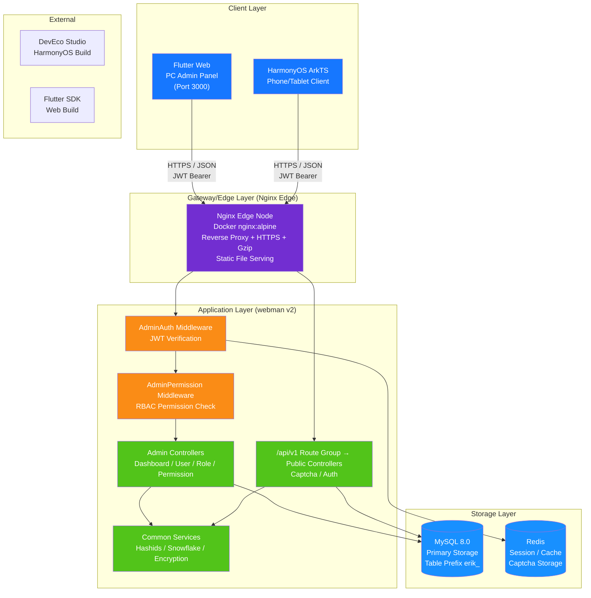

---

## 2. Backend Layered Architecture

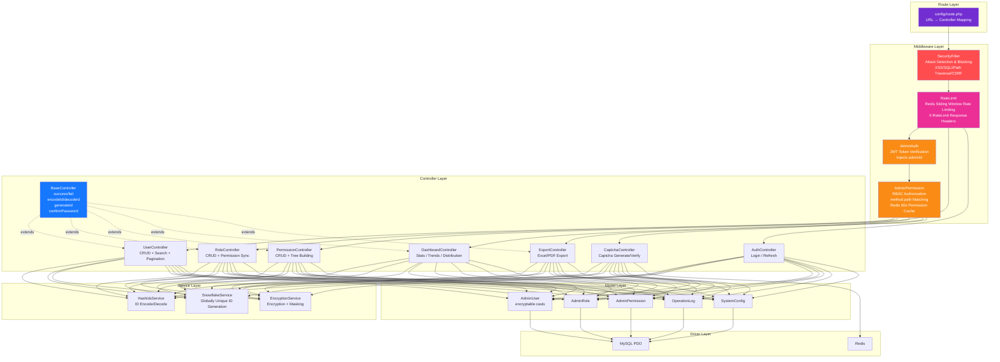

---

## 3. Request Lifecycle

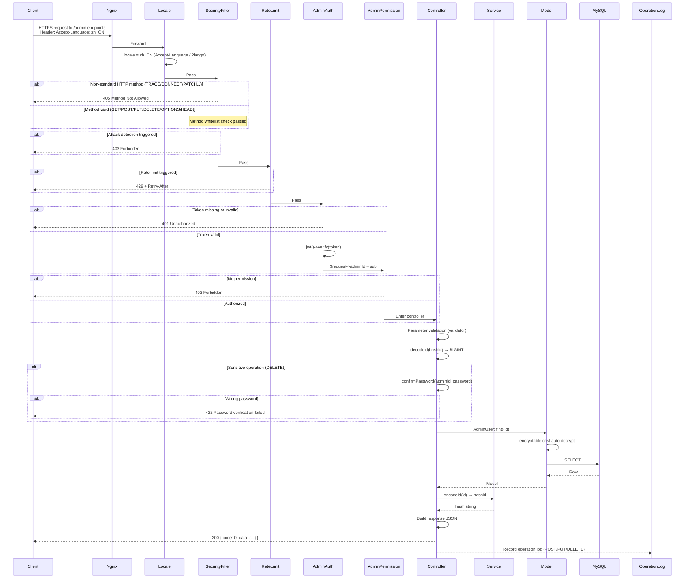

---

## 4. Authentication and Captcha Flow

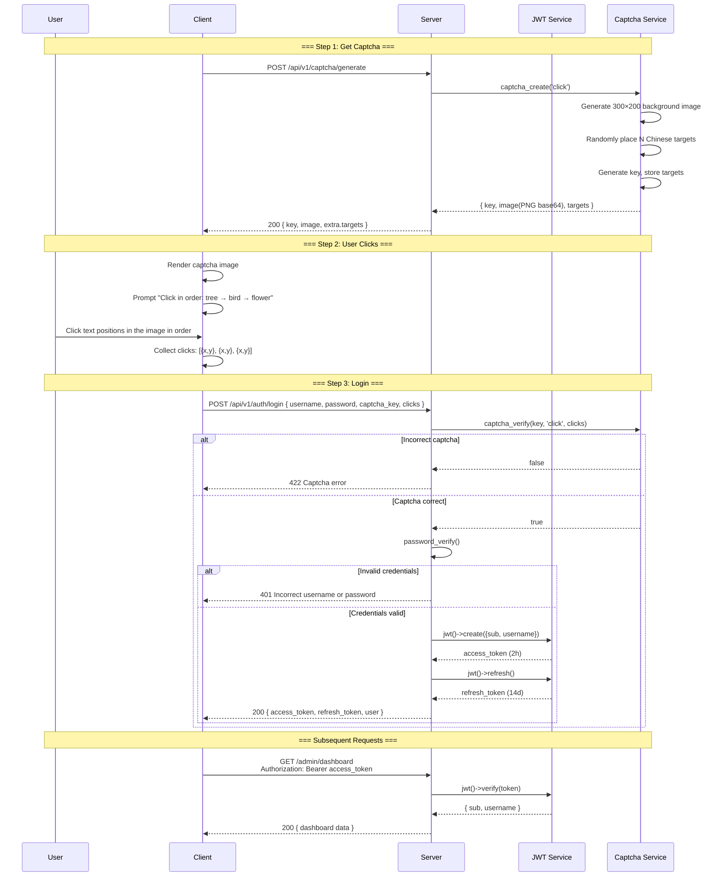

Refresh tokens: every successful `POST /api/v1/auth/refresh` rotates the access/refresh pair; the old refresh_token is blacklisted immediately and the new pair is cached for 60 seconds under `refresh_rotation:<md5(old token)>`, so resubmitting the same old token within the grace period returns the same pair. A password change clears the rotation cache and logout blacklists the cached tokens; the HarmonyOS client uses single-flight refresh for concurrent 401s.

---

## 5. RBAC Permission Model

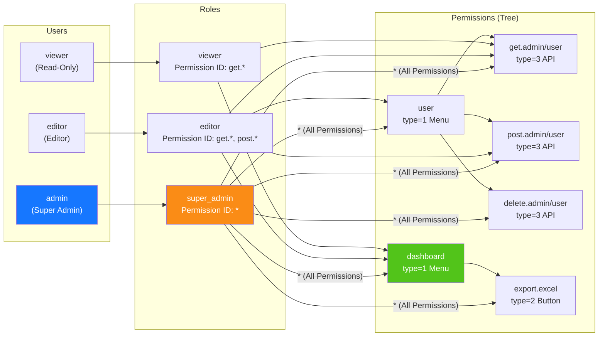

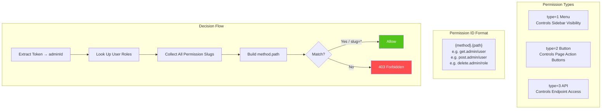

---

## 6. Full ID Lifecycle

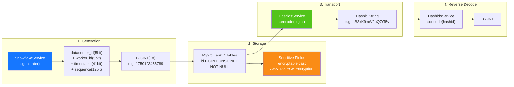

---

## 7. Data Encryption Layers

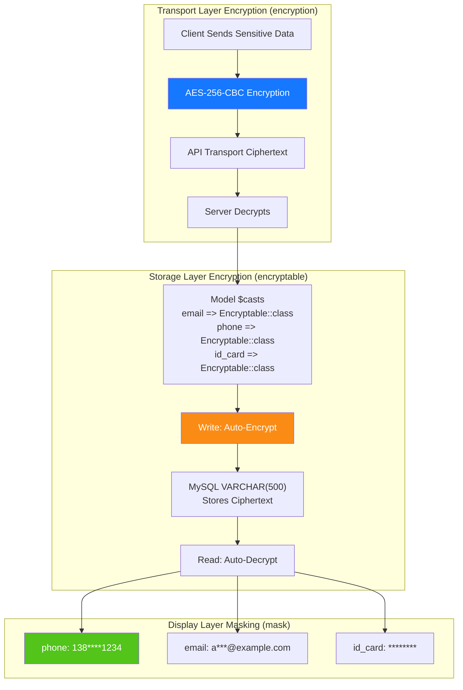

---

## 8. Database ER Relationships

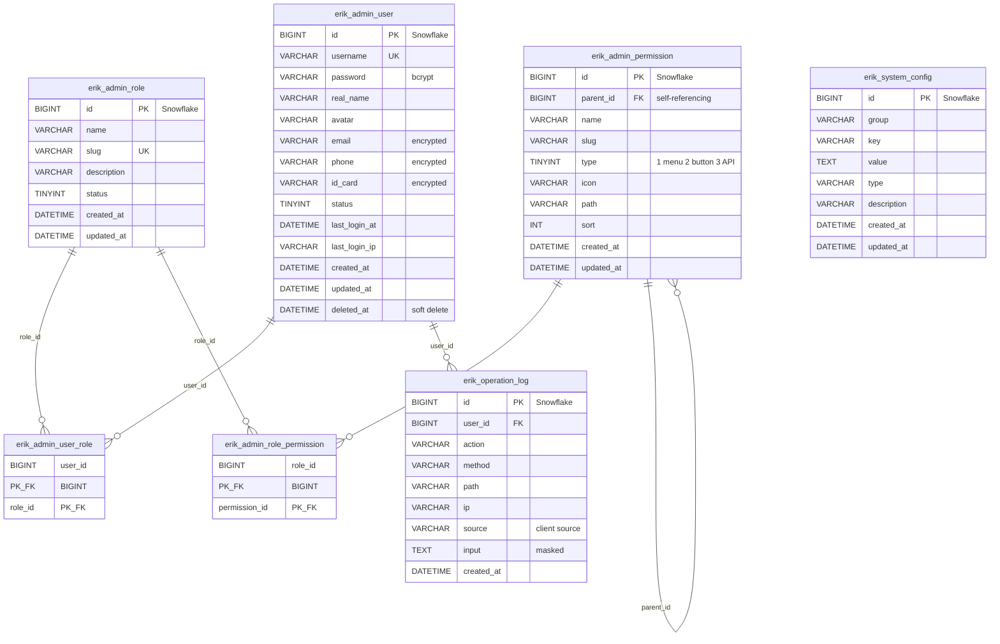

---

## 9. Export Business Flow

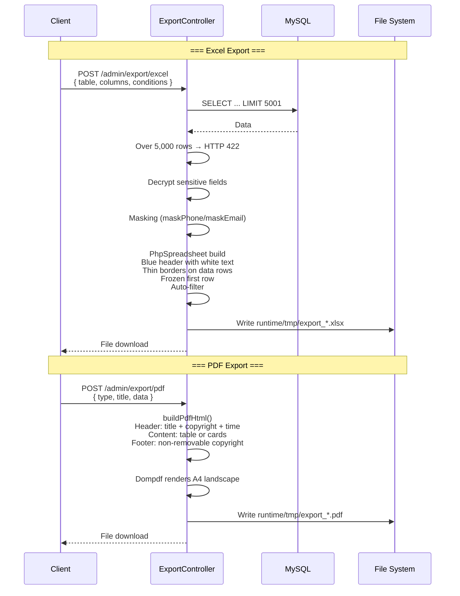

For user import, `ImportController` reads worksheet metadata (`listWorksheetInfo`) before `IOFactory::load()` and rejects any workbook with a sheet over 2,001 rows with HTTP 422; after loading it re-checks with `getHighestDataRow()`. Files are limited to 5MB and 2,000 data rows.

---

## 10. Flutter Web Widget Tree

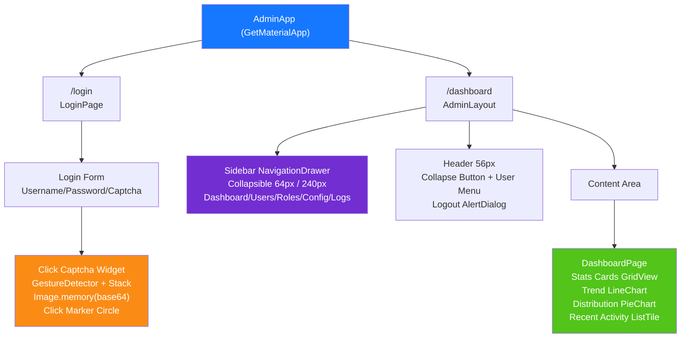

---

## 11. HarmonyOS Page Routing

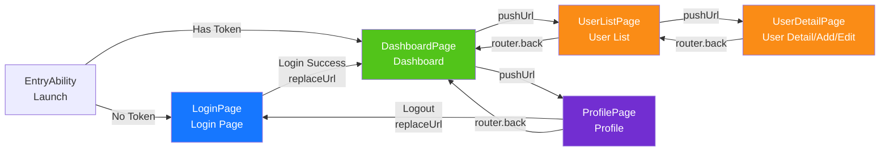

---

## 12. Defense-in-Depth Overview

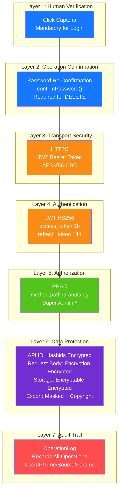

Additional notes: when Redis fails, `AdminAuth` blacklist checks and `RateLimit` return 503 (fail closed) for `/api/` and `/admin/`, while non-API paths such as `/health` and `/metrics` pass through; delete/disable operations cannot remove the last enabled super administrator, and the built-in `super_admin` role cannot be edited or deleted.

---

## 13. Deployment Topology

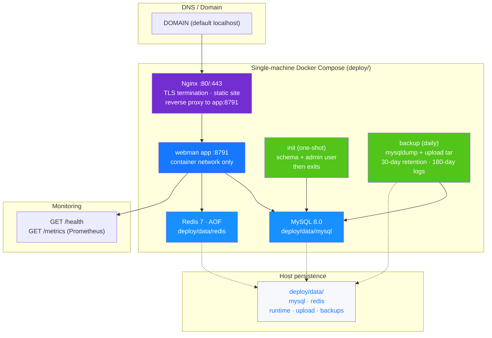

> Environment variables are isolated per service in `deploy/env/{app,init,mysql,redis,backup}.env` (`600`, directory `700`); the master `deploy/.env` only holds compose interpolation values. The app and init containers run as the host `APP_UID`/`APP_GID`. `backup` uses the least-privilege `backup_reader` user to back up the database and uploads and to delete operation logs older than 180 days; every service has a memory limit (app 512M, init 256M, mysql 768M, redis 256M, nginx 128M, backup 256M). Nginx/MySQL logs go to stdout/stderr and are rotated by Docker at `10m × 3`; HSTS is off by default and should be enabled after a real domain certificate is configured.

---

## 14. Static Design Diagrams (SVG)

The three diagrams below are **hand-written SVG** (no scripts, no external dependencies, infinitely scalable). They can be viewed without a Mermaid renderer and are ready to be inserted directly into documents, slides, and the README:

| Diagram | Content | File |
|---|------|------|
| System Architecture | Four-layer topology: client layer → gateway layer → webman application layer → storage layer, including security protection and observability | [architecture.svg](diagrams/architecture.svg) |
| Feature Design | 12 feature domains → controller entry points → key capabilities, with the middleware execution chain and data interface conventions | [features.svg](diagrams/features.svg) |
| Lifecycle | Install → startup → request intake → protection → authentication → processing → persistence → response audit, including exception branches and token lifecycle | [lifecycle.svg](diagrams/lifecycle.svg) |

> Project pet "Xiao An" asset: [`public/img/pet.svg`](../public/img/pet.svg) (pure SVG, also used as the site home page, the install wizard, and the browser icon)
