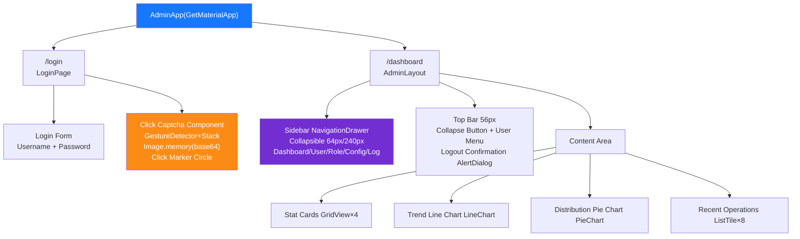
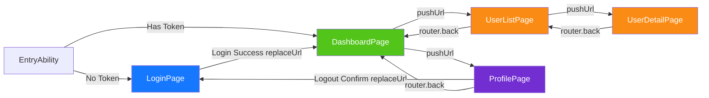

> Copyright (c) 2026 erik <erik@erik.xyz> — https://erik.xyz
>
> [中文](10-frontend-components.md) | [English](10-frontend-components.en.md)

# Frontend Component Architecture

## Flutter Web Component Tree

## HarmonyOS Page Routing

